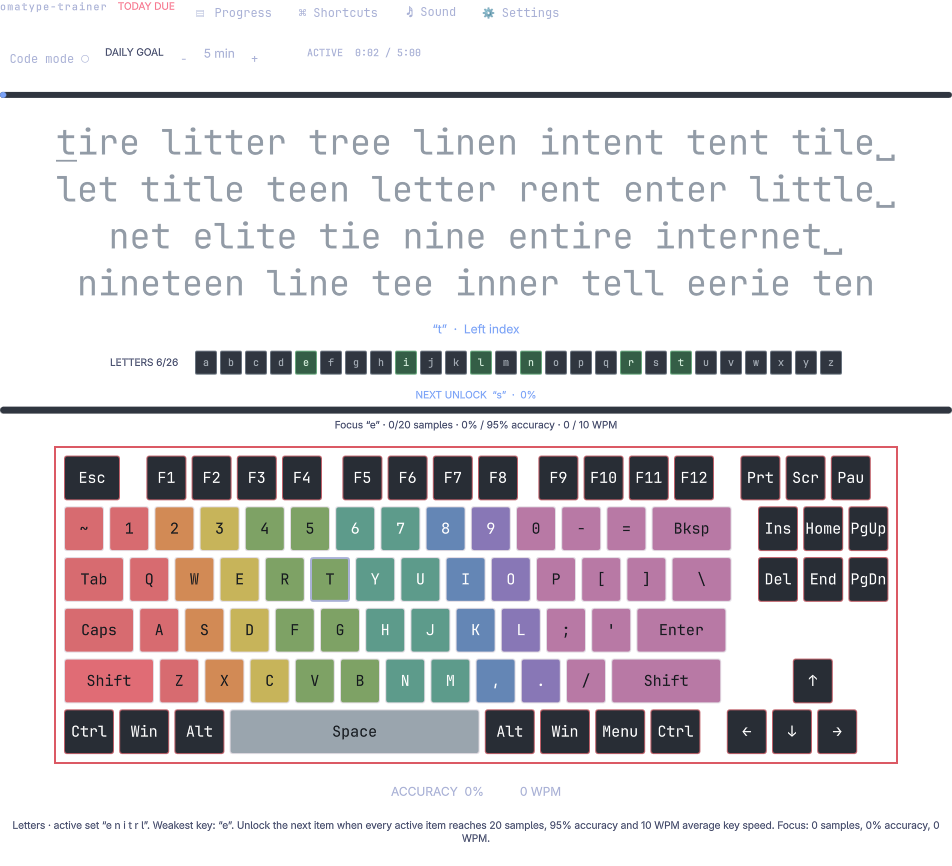
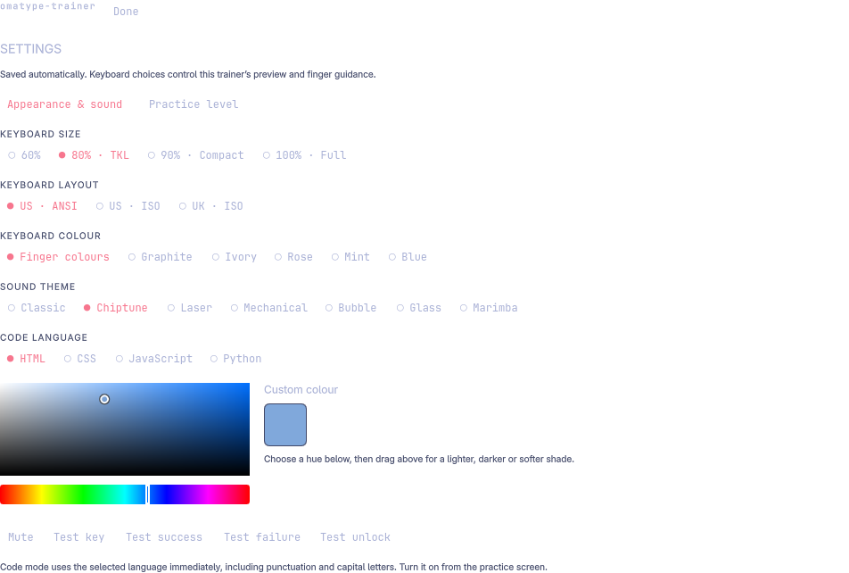

# omatype-trainer

Adaptive touch-typing practice in the Omarchy bar. It uses keybr’s English and British English dictionaries and phonetic data to make focused exercises from your available keys.



Maintained by **rocket**.

## Features

- Natural word practice that favours your weakest available key, with phonetic fallback for small vocabularies and recent-word repeat protection.
- Manual placement: choose the letter count, skip to patterns, numbers or symbols, or make all keys available. Accuracy history is preserved.
- Four-line exercises with an unlock progress bar for sample count, accuracy and speed.
- Code practice in HTML, CSS, JavaScript and Python.
- 60%, 80%, 90% and 100% keyboard previews with US ANSI, US ISO and UK ISO guidance.
- Finger colours or a visual colour picker, seven sound themes, sound previews, and mute.
- Daily goals, saved local progress, performance history, and Vim/Omarchy shortcut cards.

## Install

```sh
omarchy plugin add https://github.com/rrrrrocket/omatype-trainer.git --enable
```

The plugin ID is `io.github.rrrrrocket.omatype-trainer`. Omarchy automatically places the bar widget; use its standard bar controls to move it if desired.

## Use

Click the keyboard icon in the bar to open the trainer. Open **Settings → Practice level** to choose which keys are available. Open **Settings → Appearance & sound** to adjust the keyboard and sounds. Use **Code mode** on the practice screen for programming exercises.

## Requirements and permissions

The plugin runs as part of the Omarchy shell under the logged-in user. Practice settings and progress are saved locally to `~/.local/state/omarchy/typing-trainer.json`. Sound playback uses the `pw-play` command provided by PipeWire. No account, network connection, elevated privilege, or background service is required.

## Remove

```sh
omarchy plugin remove io.github.rrrrrocket.omatype-trainer
```

Removing the plugin stops its widget. The progress file is separate from the plugin folder and is retained.

## Screenshots

### Practice


### Settings



## License and acknowledgments

Omatype-trainer is licensed under AGPL-3.0-only. The English word lists and phonetic tables and the adapted natural-word/phonetic generator are derived from [aradzie/keybr.com](https://github.com/aradzie/keybr.com), used under AGPL-3.0. Source revision, data conversion and local changes are documented in [`THIRD_PARTY.md`](THIRD_PARTY.md). The complete license is in [`LICENSE`](LICENSE).
